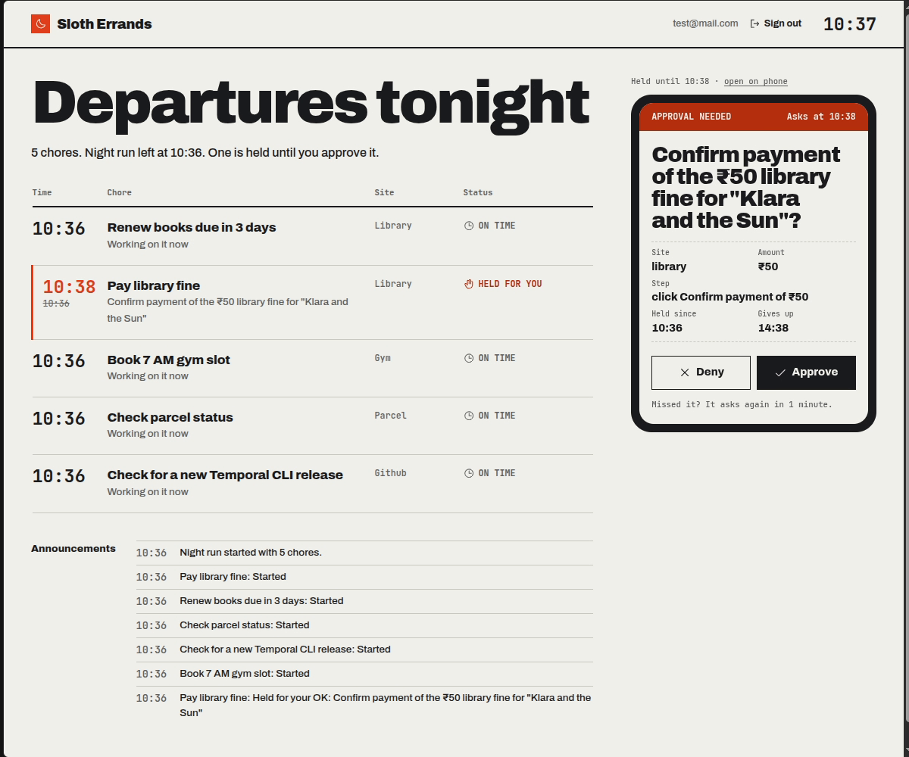
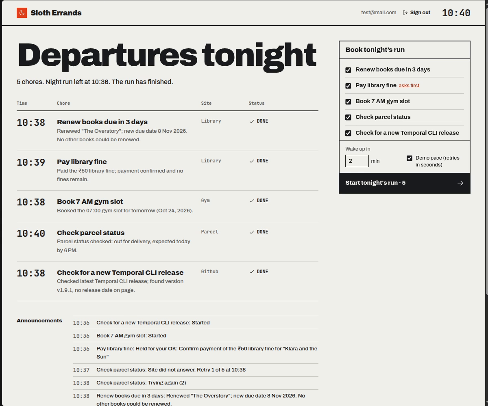

# Sloth Errands

An agent that does your boring web chores while you sleep.

Before bed you pick tonight's chores: renew library books, book the 7 AM gym slot when booking
opens, check a parcel, check for a new release. Overnight an agent on an open-weight model
(gpt-oss on Groq) does them in cloud browsers. Safe chores finish on their own. A risky step,
like paying a fine, is held. When you wake up your phone gets an Auth0 Guardian push, you tap
Approve, and only then does the agent do that one step.

Built for the Hacktoberfest 2026 DEV challenge, week 3 "Slow and Steady".



## What it shows

- **Slow and steady:** a chore can wait hours (for booking to open, for a site to come back, for
  you to wake up) and still finish. The wait is a Temporal workflow, so it survives the worker or
  the laptop restarting.
- **Lazy by design:** you set things up once. Logins are saved in Browserbase contexts, so the
  agent never sees or types a password.
- **Safe by default:** the agent cannot do a risky step on its own. Pay, confirm, delete and
  similar actions are blocked in code and turned into a proposal. Only your approval on the phone
  (Auth0 CIBA) unlocks that one action.

## How it works

```
web app (Next.js, Auth0 login)
   |  start a night / approve or deny
   v
Temporal: nightWorkflow -> one choreWorkflow per chore
   |  activities, retried with backoff
   v
Mastra agent (gpt-oss-120b on Groq)
   |  tools: open_page, read_page, do_on_page, propose_risky_action, finish
   v
Stagehand (gpt-oss-20b) driving a Browserbase browser with the site's saved login
```

One chore:

1. `prepareChore` runs the agent on the chore's page.
2. If the site is down, the workflow waits and retries (15 minutes, doubling; seconds in demo mode).
3. If the chore is waiting for something (gym booking not open yet), it checks again later.
4. If the agent reaches a risky step, it records a proposal and stops. The workflow holds it until
   your wake-up time, then sends an Auth0 CIBA request, which shows up as a Guardian push. It also
   takes Approve or Deny from the web app. No answer: it asks again later, and gives up after a
   deadline without doing anything.
5. On approval, `doApprovedStep` opens the same page and does exactly that one action.

## Stack

| Part | Tool |
|---|---|
| Agent | Mastra (`@mastra/core`), `openai/gpt-oss-120b` on Groq |
| Browser | Stagehand v4 on Browserbase, one saved context per site; `gpt-oss-20b` for page actions |
| Durable runs | Temporal TypeScript SDK, local dev server |
| Login and approval | Auth0: `@auth0/nextjs-auth0` login, CIBA with Guardian push |
| Web app | Next.js 16, Tailwind v4, Phosphor icons, motion |
| Demo sites | A small Node server (library, gym, parcel tracker), reached by Browserbase through a cloudflared quick tunnel |

## Proof

Everything runs on one laptop, so the run is recorded. See [`evidence/`](evidence/README.md)
for the timeline of a full recorded night, the demo sites' own log of what changed, the
Browserbase session list and Temporal UI screenshots.



## Run it

Needs Node 22, bun, the [Temporal CLI](https://docs.temporal.io/cli), Google Chrome (for local
mode) and cloudflared (for Browserbase mode).

Secrets go in `../.env` (one folder above the repo, so they are never committed):

```
AUTH0_DOMAIN=            AUTH0_CLIENT_ID=        AUTH0_CLIENT_SECRET=
AUTH0_SECRET=            APP_BASE_URL=http://localhost:3000
BROWSERBASE_API_KEY=     BROWSERBASE_PROJECT_ID=
GROQ_API_KEY=
```

Auth0: a Regular Web App with the CIBA grant turned on, `http://localhost:3000/auth/callback`
as a callback URL, and under Security > Multi-factor Auth, Guardian push on with the policy set
to "Always" (the first sign-in then enrolls your phone).

```
bun install && (cd web && bun install)
bun run temporal      # Temporal dev server, UI at http://localhost:8233
bun run sites         # demo sites at http://localhost:4100
bun run worker        # local Chrome; SLOTH_BROWSER=browserbase for cloud browsers
bun run web           # http://localhost:3000
```

For Browserbase: `bun run tunnel`, then `SLOTH_BROWSER=browserbase bun run login library` (and
`gym`) to save the logins, then start the worker with `SLOTH_BROWSER=browserbase`.

Without the web app: `bun run night -- --demo --wake-in 2` starts a night, `bun run try pay-fine`
runs one chore directly.

## Limits

- Groq free tier allows about 8,000 tokens a minute per model, so the worker runs one chore step
  at a time.
- Browserbase free plan: 1 browser hour a month. Test with `SLOTH_BROWSER=local` first.
- A CIBA push lives 5 minutes at most, so it is sent at wake-up time, not at 2 AM.
- The library, gym and parcel sites are demo sites. Real sites with captchas or bot checks would
  need more work.

## License

MIT
